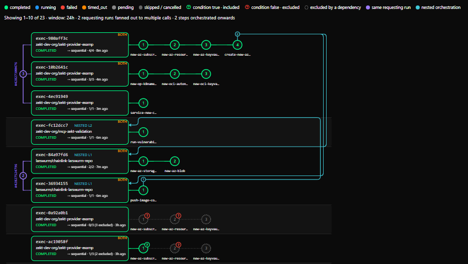

import { Aside, Steps } from '@astrojs/starlight/components';

With orchestration, one workflow asks Zekt to run several services, in order or in parallel. Each
step's outputs can feed later steps. Your workflow holds no credentials for the repositories that do
the work.

For example: *create a subscription → create a resource group in it → create a key vault in that
group*, each owned by a different team, triggered from one workflow.
[Why orchestrate with Zekt](/zekt-docs/orchestration/why-orchestrate/) explains when this helps.

## How it works

<Steps>

1. Your workflow submits a **plan**, a list of steps, each naming a service by owner and slug. It
   uses the [Zekt Action](/zekt-docs/provider/zekt-action/) with `orchestrate: true`.
2. Zekt checks that your account has an **approved subscription** to every service in the plan. If
   any step is refused, the whole submission is refused, and nothing starts.
3. Zekt dispatches each step to the service's repository and follows the run. Before each step, it
   checks the subscription again.
4. Each service reports its **outputs**, which later steps can use.
5. When the orchestration ends, Zekt sends the result back to your repository as a
   `zekt-orchestration-result` event. With `wait: true`, the action step also waits and exposes
   each step's outputs.

</Steps>

## Before you start

- The requesting repository is [enabled as a provider](/zekt-docs/provider/enable-repository/).
  Otherwise you get: *Repository '…' is not enabled for Zekt. Enable it in the Zekt portal first.*
- Your account has an approved subscription to each service you call. The approval belongs to the
  **account**, so any of your provider repositories can use it.
- Each step targets a **provider service** or a [consumer service](/zekt-docs/consumer/consumer-services/).
  Zekt looks for a provider service first. A consumer-service target must be enabled and of the
  *Subscribers fire events to me* kind.

## Submit an orchestration

```yaml
name: Provision environment
on: workflow_dispatch
permissions:
  id-token: write
  contents: read
jobs:
  provision:
    runs-on: ubuntu-latest
    steps:
      - id: orch
        uses: zekt-dev-org/zekt-action@v3
        with:
          orchestrate: true
          wait: true
          payload: |
            {
              "default_service_owner": "platform-team",
              "services": [
                {
                  "step_id": "create-sub",
                  "service_slug": "new-subscription",
                  "input": { "name": "team-a" }
                },
                {
                  "step_id": "create-rg",
                  "service_slug": "new-resource-group",
                  "input": {
                    "subscriptionId": "$zekt{{ steps.create-sub.outputs.subscription_id }}",
                    "region": "westeurope"
                  }
                }
              ]
            }
      - env:
          STATUS: ${{ steps.orch.outputs.execution_status }}
          RG: ${{ steps.orch.outputs.step_create-rg_outputs_resource_group_name }}
        run: echo "orchestration $STATUS, resource group $RG"
```

## The plan

| Field | Required | Description |
| --- | --- | --- |
| `services` | Yes | 1–20 steps. |
| `default_service_owner` | | The GitHub owner used for steps that don't set `service_owner_name`. |
| `execution_mode` | | `sequential` (the default) or `parallel`. |
| `strict_output_schema_resolution` | | `true` or `false` (the default). When `true`, a step fails at dispatch if a `$zekt{{ steps.X.outputs.Y }}` reference names a field that service X hasn't declared in its published [output schema](/zekt-docs/provider/schemas/#output-schemas) (output schemas are published on consumer services). Only applies when service X has published one, and checks the field's first path segment. |

Each step:

| Field | Required | Description |
| --- | --- | --- |
| `step_id` | Yes | Unique. Letters, digits, `_` and `-`, up to 64 characters. |
| `service_slug` | Yes | The service's orchestration identifier: lowercase kebab-case, 2–64 characters. |
| `service_owner_name` | * | The service's GitHub owner. *Either this or `default_service_owner` must be set. |
| `input` | Yes | A JSON object passed to the service. |
| `depends_on` | | A list of `step_id`s that must finish first. |
| `timeout_minutes` | | 1–1440, default 60. See [Timeouts](#timeouts-and-failures). |
| `input_schema_version` | | A semantic version of the service's input schema. |
| `condition` | | `true` or `false`, already worked out by your workflow. `false` leaves the step out. See [step conditions](#step-conditions). |
| `condition_description` | | Up to 200 characters, shown beside the condition in the console. Display only, and only allowed on a step with a `condition`. |

**Sequential:** each step waits for the previous one, unless it sets `depends_on`. **Parallel:**
every step whose dependencies are met starts at once. Plans with a dependency cycle are refused.

### Passing outputs between steps

Write `$zekt{{ steps.<step_id>.outputs.<field> }}` in a step's `input`.

<Aside type="caution">
	Use `$zekt{{ … }}`, never `${{ steps… }}`. GitHub would evaluate `${{ }}` in your own workflow
	before Zekt sees it.
</Aside>

- If the template is the **whole** JSON string, it's replaced by the typed value (number, boolean,
  object…).
- **Inside a longer string**, it's inserted as text. An object or array there fails the step.
- A reference that can't be resolved fails the step:
  *Dispatch error: Template reference to '…' failed: …*
- To make a step fail at dispatch when it references an output field the service hasn't declared, set
  `strict_output_schema_resolution: true` in the plan.

### Step conditions

Give a step a `condition` to leave it out of a run. Your workflow works out the value; Zekt never
evaluates an expression. Write the expression **without quotes** inside `payload: |`, so GitHub turns
it into a JSON `true` or `false`:

```yaml
          payload: |
            {
              "default_service_owner": "platform-team",
              "services": [
                {
                  "step_id": "create-rg",
                  "service_slug": "new-resource-group",
                  "condition": ${{ inputs.region == 'westeurope' }},
                  "condition_description": "Only in West Europe",
                  "input": { "region": "westeurope" }
                }
              ]
            }
```

- **`true`, or no `condition`:** the step runs as before. A plan without conditions behaves exactly as
  it always did.
- **`false`:** the step is **excluded**. It's never sent to the service, and costs nothing.
- **Steps that depend on it are excluded too**, and so on down the chain. A step depends on another
  if it lists it in `depends_on`, or reads its outputs with
  `$zekt{{ steps.<step_id>.outputs.<field> }}`, even without `depends_on`.
- **Excluded isn't a failure.** An orchestration whose steps all completed or were excluded ends
  `completed`. If every step is excluded, the orchestration completes at once and nothing is sent to
  any service, but the [result event](#the-result-event) is still sent.
- **In `sequential` mode**, a step without its own `depends_on` waits for the nearest earlier step
  that isn't excluded. For example, in *build → scan → ship* with scan's condition `false`, build
  runs, then ship.

<Aside type="caution">
	Don't quote the expression. `"condition": "${{ … }}"` arrives as the text `"false"`, and the whole
	orchestration is refused. An expression that renders to nothing (`"condition": ,`) makes the
	payload invalid JSON; zekt-action 3.3.0 says so in its error.
</Aside>

Every step is checked when you submit, excluded or not: an excluded step naming a service you can't
call still refuses the whole plan. Excluded steps also count towards the 20-step limit.

With `wait: true`, read each step's final state from the action's `step_<step_id>_status` output. An
excluded step sets no `step_<step_id>_outputs_*` outputs. See
[Zekt Action outputs](/zekt-docs/reference/zekt-action/#outputs).

Conditions can't do these:

- Zekt doesn't evaluate expressions. The value must already be `true` or `false` when you submit.
- A condition can't use an earlier step's outputs.
- No step runs when a step it depends on was excluded or failed. There's nothing like GitHub's
  `if: always()`.
- There's no condition on the whole orchestration. Use GitHub's own `if:` on the step that submits it.

## The result event

When an orchestration ends, in any final state, Zekt sends a `zekt-orchestration-result`
`repository_dispatch` to the requesting repository. It's retried for up to 24 hours. It only runs
something if a workflow listens for it:

```yaml
name: Orchestration finished
on:
  repository_dispatch:
    types: [zekt-orchestration-result]
jobs:
  report:
    runs-on: ubuntu-latest
    steps:
      - env:
          EXECUTION: ${{ github.event.client_payload.execution_id }}
          STATUS: ${{ github.event.client_payload.status }}
          STEPS: ${{ toJSON(github.event.client_payload.steps) }}
        run: |
          echo "orchestration $EXECUTION ended: $STATUS"
          echo "$STEPS" | jq .
```

`client_payload` carries `dispatch_id`, `execution_id`, `status`, `execution_mode`, `total_steps`,
`completed_steps`, `completed_at`, `failed_at_step`, `error_message` and `steps` (each with
`step_id`, `service_slug`, `status` and `outputs`).

A step that had a [condition](#step-conditions), or was excluded, also carries:

| Field | Value |
| --- | --- |
| `condition` | `true` or `false`. `null` on a step excluded because of another step. |
| `condition_description` | The step's description, if it set one. |
| `exclusion_reason` | `condition_false` when its own condition was `false`, even if an earlier step was excluded too. `dependency_excluded` when it was excluded because a step it depends on was. |
| `excluded_by` | For `dependency_excluded`: the step whose condition caused it. |

An excluded step has no `outputs`. A step without a condition that wasn't excluded has exactly the
fields it always had.

`completed_steps` counts only the steps that ran, so it can be lower than `total_steps` on a
`completed` orchestration. The result event has no count of excluded steps: count the steps whose
`status` is `excluded`.

## Timeouts and failures

- `timeout_minutes` limits how long Zekt waits for the service's run to **start**. A step that
  hasn't started in time becomes `timed_out`, and so does the orchestration. Once a run has started,
  GitHub's result decides the outcome.
- A failed step fails the orchestration. Steps that haven't started become `skipped`. Parallel steps
  already running continue. Steps that were already excluded stay `excluded`.
- Keep the two apart: **skipped** means the step never ran because the orchestration failed, timed
  out or was cancelled. **Excluded** means a [condition](#step-conditions) left it out.
- If a subscription is revoked mid-way, the next step that needs it fails: *The subscription to
  service '…' is no longer active, so this step was not dispatched. Subscribe again to run it.*

| Step states | Orchestration states |
| --- | --- |
| pending, waiting, dispatching, running, completed, failed, skipped, timed_out, excluded | pending, running, completed, failed, timed_out, cancelled |

## Nested orchestrations

A service called by a step can orchestrate further. Its own workflow, while running for that step,
submits an orchestration with the Zekt Action's `orchestrate: true`. That **child** orchestration is
linked to the **parent** step automatically: the workflow passes nothing extra.

<Aside>
	It only counts as nested when it's submitted from the same workflow run that's servicing the step,
	while the step is still in progress. Submitted later (for example from a re-run of a finished
	step's workflow) or from another run, it's an ordinary top-level orchestration, paid for by the
	account that submitted it.
</Aside>

### Depth and loops

- The top-level orchestration is depth 0. Below it come up to **5 nested levels**. The console tags
  them **NESTED L1**, **NESTED L2** and so on.
- A repository can't submit an orchestration if it already submitted one higher up in the same chain.
  A step can still call a service in that repository; only that repository's workflow submitting
  another orchestration is refused.
- Going deeper than 5 levels, or looping back, refuses the child's submit and creates nothing (see
  [Refusals](#refusals)). Zekt doesn't fail the parent step for it: the step ends with its own
  workflow run. If the refused Zekt Action step fails that run, the parent step fails.

### How the parent step finishes

- The parent step waits for its child orchestrations, not only for its own run. If the run succeeds
  while a child is still going, the step stays `running` until the last child finishes.
- When every child completed, the step completes.
- A child that ends failed, timed out or cancelled (whoever cancelled it) fails the parent step at
  once, even while the step's own run is still going: *Child orchestration '&lt;exec-id&gt;' ended
  failed* (or *ended timed_out*, *ended cancelled*). The parent orchestration then fails as it does
  for any failed step.
- If the step's own run fails, the step fails with *Workflow concluded with: &lt;conclusion&gt;*, whatever
  its children do.
- `timeout_minutes` still only limits how long Zekt waits for the step's run to start. It doesn't cut
  short the wait for children: each child is bounded by its own steps' timeouts.
- [Conditions](#step-conditions) work in a child plan as anywhere else. If every step of a child is
  excluded, the child completes at once with no outputs, and the parent step finishes when its own
  run does.

### Outputs

A child's outputs never reach the parent step automatically. The parent step's outputs are what the
service's own workflow reports. To pass something up, that workflow submits the child with
`wait: true`, reads the child's `step_<step_id>_outputs_<field>` outputs, and reports them as its
own.

### Cancelling

- Cancelling an orchestration also cancels its children that are still in flight, and theirs, all the
  way down. Their unfinished steps read *Cancelled because parent orchestration '&lt;id&gt;' was
  cancelled*.
- Cancelling doesn't stop GitHub workflow runs that are already running.
- A parent that fails on its own, because its run fails, doesn't cancel its children. They keep
  running.

### Who requests, receives and pays

- The child's **requester** is the account of the service repository whose workflow submitted it.
  That account's approved subscriptions authorize the child's steps, and its own limit on concurrent
  orchestrations applies.
- The child's `zekt-orchestration-result` event goes to that submitting repository, not to the
  top-level requester.
- The account that started the **top-level** orchestration pays for the whole chain, nested levels
  included. Both that account and the submitting account must be in good standing. See
  [zekt.dev/zekt-pricing](https://www.zekt.dev/zekt-pricing.html).

### Who sees what

| You are | You see |
| --- | --- |
| The parent's requester | In the parent step's detail, under *Nested orchestrations submitted while servicing this step*: how many children there are, and each one's status, timing, total and completed steps, and depth. The child's repository shows as *service-owned*. You don't see the child's steps, services, repositories, run links, inputs or outputs, you can't open it, and it isn't a row in your Overview. |
| The service owner whose workflow started the child | The child in full: you're its requester. It reads *Nested orchestration (level N) — submitted while servicing step &lt;step&gt; of &lt;exec-id&gt;*. **Open parent** appears only if you also own the parent; otherwise it says *owned by the requesting account*. |
| A service owner the child calls | The child in your Overview *As Service Owner*, like any orchestration that calls your services, with run links for your own steps only, and no excluded steps. |

## Warnings

If Zekt has advisory warnings about a submitted plan, they appear as `::warning::` annotations in
your workflow log. Warnings don't stop the orchestration.

## Refusals

Any refusal when you submit refuses the whole orchestration:

- *Service '&lt;owner&gt;/&lt;slug&gt;' not found or you are not authorized to use it.* This covers a
  service that doesn't exist, one you have no subscription to, and one that can't be called. Check
  your subscription to that owner and slug.
- *Rate limit exceeded: maximum N concurrent orchestrations per customer.*
- *This account cannot start new orchestrations: &lt;reason&gt;. Resolve billing to continue.* The reason
  is *Account suspended: …*, *Account has an open payment dispute* or *Grace period ended without
  payment*. See [billing](/zekt-docs/billing/how-billing-works/#when-a-payment-fails).
- *Step '&lt;id&gt;' has an invalid condition: expected true or false, got a string. Write the expression
  unquoted, for example "condition": `${{ inputs.region == 'westeurope' }}`.* Instead of *a string*,
  it can say *a number*, *null*, *an object* or *an array*. The usual cause is a quoted expression.
- *Step '&lt;id&gt;' has a condition_description but no condition.*
- *Step '&lt;id&gt;' condition_description is &lt;n&gt; characters; the maximum is 200.*
- *Orchestration nesting depth exceeded: maximum 5 levels of nested orchestration. A service reached
  through an orchestration step may itself orchestrate, but the chain must terminate.* The Zekt
  Action shows it as *Failed to submit orchestration (HTTP 429): …*.
- *Orchestration cycle detected: '&lt;owner&gt;/&lt;repo&gt;' already appears earlier in this
  orchestration chain. A repository cannot orchestrate back into itself, directly or through
  intermediate services.*
- *Could not verify whether this orchestration is nested inside another. Nothing was created; retry
  the submission.* This is temporary: submit again.
- *The account paying for this orchestration is not in good standing; nothing was created.* For a
  [nested orchestration](#who-requests-receives-and-pays), the paying account is the one that started
  the top-level orchestration.

## Limits

- 20 steps per orchestration, excluded steps included.
- 5 orchestrations running at once per account by default. Contact support to raise it.
- Nesting depth 5: the top-level orchestration plus up to 5 [nested](#nested-orchestrations) levels.
  A repository can't submit an orchestration if it already submitted one higher up the same chain.
- [Shield](/zekt-docs/add-ons/shield/) doesn't encrypt orchestration inputs and outputs.

## Cost

The account that starts the orchestration pays for all of it, including any
[nested orchestrations](#who-requests-receives-and-pays). See
[zekt.dev/zekt-pricing](https://www.zekt.dev/zekt-pricing.html).

## Follow orchestrations in the console

Go to **Management → Orchestrations**:

| Tab | Shows |
| --- | --- |
| **Overview** | A graph of recent orchestrations, filtered *All*, *As Requester* or *As Service Owner*. See [the Overview graph](#the-overview-graph). |
| **Orchestration Requests** | Orchestrations you submitted, with step detail and outputs. |
| **Orchestration Processing** | Steps dispatched by you or to you. |
| **Service Invocations** | Who calls your services, and how those calls went. |

As the requester, you see each service as owner/slug, with its status, timing, errors and outputs.
Run links for service steps are visible only to the service owner. The service owner sees the
requesting repository and the run links of its own steps.

Steps with [conditions](#step-conditions):

- A step with a condition shows a **?** badge: green when the step was included, red when it was
  excluded. Red means excluded, never failed: the step itself is drawn grey and dotted, as not run.
  The badge's tooltip shows the value and its type, for example `false · Boolean`, then the
  description.
- A step excluded because of another step has no badge. Its tooltip names the step that excluded
  it.
- **Orchestration Processing** has an `excluded` filter. A finished orchestration's progress reads
  like *1/3 steps · 2 excluded*.
- A service owner never sees an excluded step of someone else's orchestration, in **Overview**
  (*As Service Owner*), **Orchestration Processing** or **Service Invocations**. It was never sent
  to them.

### The Overview graph

**Orchestrations Overview** draws recent orchestrations as cards, each followed by its steps.



- **Toolbar:** the window (**Last 1h**, **Last 24h**, the default, or **Last 7d**), the role
  (**All**, **As Requester** or **As Service Owner**), a search box for an exec id, requesting
  repository or run id, and 10 (the default), 20, 50 or 100 **rows** per page.
- **What loads:** at most the 100 most recent orchestrations in the window, across both roles. A page
  never splits the orchestrations of one requesting run, so it can hold more rows than its size. The
  graph refreshes every 5 seconds while anything is active, otherwise every 30 seconds.
- **Header:** how many orchestrations are shown, and the window. When they apply, it adds how many
  requesting runs **fanned out** (submitted two or more orchestrations), and how many steps
  **orchestrated onwards** (started a nested orchestration).
- **Cards:** `exec-` and the first 8 characters of the id, the requesting repository, the status, the
  mode (**⇉ parallel** or **→ sequential**), completed and total steps (with *n excluded* when any
  were), and how long ago it was submitted.
  - **SERVICE OWNER** means you own a service it calls but didn't submit it. **BOTH** means you
    submitted it and also own a service one of its steps calls. There's no tag when you're only the
    requester.
  - **NESTED L&lt;n&gt;** marks a [nested orchestration](#nested-orchestrations) and its level.
- **Purple bracket** (*same requesting run*): joins the orchestrations one workflow run submitted,
  with their count and the run number. Click it to show only that run.
- **Teal** (*nested orchestration*): a mark on a step whose workflow run submitted nested
  orchestrations, and a line from that step to the child's card when both are on the same page. As
  the parent's requester you don't see the child's card, so you see the mark but not the line.
- **Legend:** the status colours are always shown. The condition entries appear only when a shown
  orchestration uses conditions, and *same requesting run* and *nested orchestration* only when the
  page has them.
